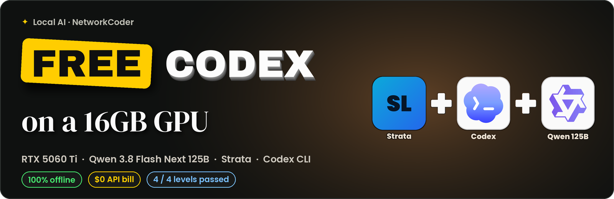
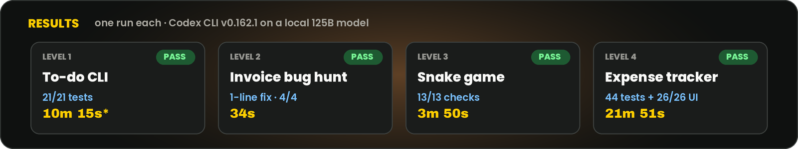

<p align="center">
  
</p>

<p align="center">
  <a href="https://www.youtube.com/watch?v=b2T5ineu7ek"></a>
  
  
  
  
</p>

# Codex on a 16GB GPU

Everything behind the NetworkCoder video **"I Ran Codex for FREE on a 16GB GPU"**: the exact setup, the config, the prompts, the test inputs, the raw results and the key test results. Use it to check the numbers or rerun the tests yourself.

**Stack:** RTX 5060 Ti 16GB · Qwen 3.8 Flash Next 125B (IQ3_S, 3-bit) · [Strata](https://github.com/Niko1221/Strata) v0.1.39 · OpenAI Codex CLI v0.162.1 · 100% offline

## ▶️ Watch the video

<a href="https://www.youtube.com/watch?v=b2T5ineu7ek">
  
</a>

---

## Results

<p align="center"></p>

| Level | Job | Result | Time* |
|---|---|---|---|
| 1 | Python to-do CLI + tests | ✅ 21/21 tests (1.41s) | 10m 15s |
| 2 | Find the bug in an invoice calculator | ✅ 1-line fix, 4/4 tests, tests untouched | 34s |
| 3 | Snake game in one HTML file | ✅ 443 lines, 13/13 headless checks | 3m 50s |
| 4 | Expense tracker (FastAPI + SQLite + vanilla JS) | ✅ 44 tests + 26/26 UI checks, found & fixed a real SQLite threading bug | 21m 51s |

\* Codex's own "Worked for" time. **Level 1's time is inflated**: another job was sharing the engine during that run. Levels 2–4 ran clean.

Level 1 used **145,984 tokens** (140,397 input, 5,587 output). Cost: **$0**.

Full log: [`results/Codex_results_log.md`](results/Codex_results_log.md) · Test results: [`test-results/`](test-results/)

## Engine speed (Strata, measured on this PC)

| | |
|---|---|
| Auto-tune (CPU workers 47 → 31 → 24, then expert-cache tuning) | 39.0 → 57.8 → 73.5 → **77.7 tok/s** |
| Chat decode | 69.7 tok/s (first token 0.50 s) |
| Prompt reading, 4K / 16K | 1,125 / 1,634 tok/s |
| Agent decode | 74.2 tok/s |
| Agent prompt-cache hit | 68.8% (avg turn first token 3.82 s) |
| Experts in RAM / cached on GPU | 46.8 GiB / ~4,600 experts (8.8 GiB) |

Benchmark run at 64K context; the Codex tests ran at 128K. See `test-results/02_strata_tuned_77.7_tok_s.png` and `03_strata_benchmark.png`.

---

## Setup

### 1. Hardware check
```bash
nvidia-smi        # RTX 5060 Ti, 16311 MiB
```

### 2. Strata (v0.1.39 or newer)
v0.1.39 added the OpenAI **Responses** endpoint (`/v1/responses`) that Codex needs. Install Strata, pick **Qwen 3.8 Flash Next (IQ3_S)** in its setup, and let it self-tune. It serves an OpenAI-compatible API at `http://127.0.0.1:8082/v1`.

Strata: <https://github.com/Niko1221/Strata>

### 3. Install Codex
```bash
npm i -g @openai/codex
codex --version   # codex-cli 0.162.1
```

### 4. Point Codex at Strata — `~/.codex/config.toml`
```toml
model_reasoning_effort = "medium"
model = "strata"
model_provider = "strata"
model_context_window = 131072
show_raw_agent_reasoning = true

[model_providers.strata]
name = "Strata (local)"
base_url = "http://127.0.0.1:8082/v1"
wire_api = "responses"
stream_idle_timeout_ms = 600000
```
- `wire_api = "responses"`: uses Strata's Responses endpoint.
- `stream_idle_timeout_ms = 600000`: gives a local model 10 minutes to think before Codex times out.
- Codex warns that it doesn't know a model called `strata` and uses default metadata. That's harmless.

### 5. Quick test
```bash
mkdir -p ~/codex_test && cd ~/codex_test && git init -q
codex exec "Say hello and list the files in this folder"
# header should show: model: strata / provider: strata
```

### 6. Two snags (and the fixes)
1. **`--full-auto` no longer exists** in v0.162.1:
   ```
   error: unexpected argument '--full-auto' found
   ```
2. **The sandbox failed on the test machine**, even after `apt install -y bubblewrap`:
   ```
   bwrap: No permissions to create new namespace ...
   ```
   Launch used instead (shows as **"YOLO mode"**):
   ```bash
   codex --sandbox danger-full-access --ask-for-approval never
   ```
   > ⚠️ Only do this on a throwaway machine or inside a container. On your own computer, keep the sandbox on.

---

## Rerun the tests

Each level runs in its own empty folder (`~/codex_test/l1_todo`, `l2_invoice`, `l3_snake`, `l4_expenses`).

**Level 1 — to-do CLI**
```
Build a command-line to-do app in Python: todo.py.
Commands: add "<text>", list, done <id>, delete <id>. Save tasks to tasks.json in this folder.
List shows id, [x] or [ ], and the text. Unknown id prints "ERR: no such task".
Write pytest tests in test_todo.py covering every command and the error, run them, and fix until all pass.
```

**Level 2 — find the bug.** Build the buggy project first:
```bash
bash tests/level2_invoice/make_codex_l2.sh
```
```
This is a shop's invoice calculator. Some tests in test_invoice.py are failing. Find the root cause, fix it in invoice.py (do not change the tests), and run the tests unti…
```

**Level 3 — Snake**
```
Create snake.html: a complete Snake game in one HTML file (no libraries). Arrow keys to move, food grows the snake, score shown on screen, speed increases every 5 food, ga…
```

**Level 4 — expense tracker.** Put [`tests/level4_expenses/bank_statement.csv`](tests/level4_expenses/bank_statement.csv) (22 sample transactions) in the folder.
```
Build a personal expense tracker web app in this folder:
- Python FastAPI backend + SQLite, single-page HTML/JS frontend (no frameworks)
- add / edit / delete expenses (da…
```
Expected import (browser check, `test-results/L4_expenses_CSV_import.mp4`): 22 imported, 0 skipped, 0 invalid. Food 6 · Transport 4 · Bills 3 · Entertainment 3 · Income 2 · Health 2 · Shopping 1 · Rent 1. Re-importing the same file gives 0 imported, 22 duplicates.

---

## Honest limits
- Slower than a cloud model: 22 minutes for the big app.
- One request at a time on one card.
- No web search in this setup.
- One run per test. Your results will vary.

## Test results
| File | Shows |
|---|---|
| `01_codex_config_strata.png` | Codex pointed at Strata |
| `02_strata_tuned_77.7_tok_s.png` | Strata auto-tune: 77.7 tok/s |
| `03_strata_benchmark.png` | Strata benchmark |
| `L1_todo_PASS_21_tests.png` | Level 1: 21/21 tests |
| `L2_invoice_PASS_bug_fixed_34s.png` | Level 2: bug fixed in 34s |
| `L3_snake_PASS_13_checks.png` | Level 3: 13/13 checks |
| `L4_expenses_PASS_44_tests.png` | Level 4: 44 tests |
| `L4_expenses_CSV_import.mp4` | Level 4: CSV import in the browser |

---

<p align="center">
  Made by <b>NetworkCoder</b> · <a href="https://www.youtube.com/watch?v=b2T5ineu7ek">Watch the video</a> · ⭐ Star the repo if it helped
</p>
